# Sistem Dispatching dan Manajemen Alokasi Hero Pada Agensi Penugasan Pahlawan

Program aplikasi konsol berbasis Python untuk mengelola dan memproses pengiriman (*dispatch*) superhero pada sebuah agensi penugasan pahlawan. Program ini menerapkan prinsip Pemrograman Berorientasi Objek (OOP) seperti Enkapsulasi, Properties, Inheritance, Relasi UML (Asosiasi, Agregasi, Komposisi), Abstraksi (Abstract Base Class), Polimorfisme, serta prinsip SOLID dan beberapa jenis method.

===============================================================================================================================================

## Ringkasan Penjelasan Program

Program ini dibuat untuk mensimulasikan alur kerja operasional agensi hero. Sistem ini memiliki beberapa bagian utama:

1. **Manajemen Hero (`Hero`)**
   Class `Hero` adalah *abstract class* sekaligus superclass untuk jenis hero lain. Class ini menyimpan nama hero, status kesiapan hero (*Standby/Resting*), power level, dan persentase sukses.
   Data penting seperti `persentase_sukses` disimpan secara private dan diakses melalui getter/setter.

2. **Spesialisasi Hero (Inheritance)**
   Program memiliki beberapa subclass dari `Hero`, yaitu:
   - `HeroCombat`
   - `HeroIntelligence`
   - `HeroMobility`
   - `HeroVigor` (subclass tambahan sebagai contoh OCP, ditambahkan tanpa mengubah `Hero`)

   Setiap subclass memiliki atribut unik yang membedakannya dari parent class maupun subclass lainnya.

3. **Manajemen Operator (`Dispatcher`)**
   Class `Dispatcher` mengelola operator yang bertugas mengirim tim hero ke sebuah misi. Dispatcher memeriksa jumlah hero, status kesiapan hero, lalu meminta sebuah penilai (`MissionEvaluator`) untuk menilai apakah tim layak menjalankan misi.

4. **Penilaian Misi (`MissionEvaluator`)**
   Abstract class dengan dua penilai konkret, yaitu `TypeEvaluator` (menilai kecocokan tipe hero) dan `SuccessRateEvaluator` (menilai rata-rata persentase sukses tim).

5. **Manajemen Misi (`Misi`)**
   Class `Misi` menyimpan detail misi seperti ID misi, nama kejadian, lokasi, syarat tipe hero, reward reputasi, dan batas waktu respon.

6. **Manajemen Agensi (`Agency`)**
   Class `Agency` digunakan untuk menampung daftar hero dan dispatcher. Relasi ini menunjukkan konsep agregasi.

7. **Pencatatan Dispatch (`DispatchLog`)**
   Class `DispatchLog` digunakan untuk mencatat hasil dispatch, apakah sukses atau gagal. Log ini dibuat dan disimpan oleh `Dispatcher`.

8. **Panggilan Darurat (`Competingcalls`, `Hackcalls`)**
   Dua jenis panggilan yang tidak berhubungan lewat pewarisan tetapi sama-sama memiliki method `tangani()`, dipakai untuk contoh duck typing.

===============================================================================================================================================

## Fitur Utama Program

Program menjalankan simulasi otomatis yang mencakup fitur-fitur berikut:

* **Pengelolaan Data Hero**
  - Membuat objek hero dari beberapa subclass.
  - Menampilkan data hero.
  - Menghitung total hero.
  - Mengubah maksimal jumlah hero dalam tim dispatch menggunakan `@classmethod`.
  - Memvalidasi tipe hero menggunakan `@staticmethod`.

* **Inheritance, Abstraksi, dan Polimorfisme**
  - `Hero` sebagai abstract class dengan 2 abstract method.
  - `HeroCombat`, `HeroIntelligence`, `HeroMobility`, dan `HeroVigor` sebagai subclass yang mengimplementasikan seluruh abstract method.
  - Method `tampilkan_stats()` dan `aksi_khusus()` dioverride oleh setiap subclass.
  - Duck typing pada `Competingcalls` dan `Hackcalls`.
  - Operator overloading `__lt__` dan `__str__`.

* **Pengelolaan Misi**
  - Membuat data misi.
  - Menampilkan detail misi.
  - Menyimpan reward reputasi dengan validasi melalui setter.
  - Menyimpan batas waktu respon default sebesar 60 detik.

* **Pengelolaan Dispatcher**
  - Menampilkan info operator.
  - Verifikasi kode akses operator.
  - Menjalankan dispatch tim hero ke misi dengan penilai yang dapat diganti (DIP).
  - Menyimpan log hasil dispatch.

* **Manajemen Status Hero**
  - Hero yang selesai menjalankan misi berubah status menjadi `Resting`.
  - Hero dapat dipulihkan kembali menjadi `Standby` melalui method `beristirahat()`.

* **Validasi & Exception Handling**
  - Validasi `persentase_sukses`.
  - Validasi `total_dispatch`.
  - Validasi `reputasi_reward`.
  - Setter `status` pada `Hero` serta property read-only `nama`, `tipe_hero`, dan `id_hero`.
  - Pengujian data valid dan tidak valid menggunakan `try-except`.

* **Pembersihan Terminal**
  - Program menggunakan fungsi `lanjut()` untuk menunggu input Enter dari user, lalu membersihkan terminal sebelum lanjut ke pengujian berikutnya.

------------------------------------------------------------------------------------------------------------------------------------------------

## Struktur Kode & Kelas

Program terdiri dari dua file: `posttest3_2509106066_AryasatyaRakhaPhanyputa.py` (definisi kelas) dan `main.py` (pengujian). Berikut ringkasan struktur kelas dan kode dalam bentuk tabel.

### Ringkasan Seluruh Kelas

| No | Kelas / Fungsi | Jenis | Induk | Peran |
|---|---|---|---|---|
| 1 | `Hero` | Abstract class (`ABC`) | - | Superclass seluruh hero |
| 2 | `HeroCombat` | Subclass | `Hero` | Hero tipe Combat |
| 3 | `HeroIntelligence` | Subclass | `Hero` | Hero tipe Intelligence |
| 4 | `HeroMobility` | Subclass | `Hero` | Hero tipe Mobility |
| 5 | `HeroVigor` | Subclass | `Hero` | Hero tipe Vigor (contoh OCP) |
| 6 | `MissionEvaluator` | Abstract class (`ABC`) | - | Abstraksi penilai misi (DIP) |
| 7 | `TypeEvaluator` | Subclass | `MissionEvaluator` | Penilai berdasarkan kecocokan tipe hero |
| 8 | `SuccessRateEvaluator` | Subclass | `MissionEvaluator` | Penilai berdasarkan rata-rata persentase sukses |
| 9 | `DispatchLog` | Class biasa | - | Pencatat hasil dispatch (komposisi) |
| 10 | `Dispatcher` | Class biasa | - | Operator yang mengirim tim hero |
| 11 | `Misi` | Class biasa | - | Data misi |
| 12 | `Agency` | Class biasa | - | Penampung hero dan dispatcher (agregasi) |
| 13 | `Competingcalls`, `Hackcalls` | Class biasa | - | Contoh duck typing |
| 14 | `proses_panggilan()` | Fungsi | - | Memanggil `tangani()` pada objek apa pun |

### 1. `Hero` (abstract class)

Class `Hero(ABC)` adalah superclass sekaligus abstract class untuk seluruh jenis hero. Class ini tidak dapat diinstansiasi langsung.

| Komponen | Nama | Keterangan |
|---|---|---|
| Atribut class | `total_hero` | Penghitung jumlah hero yang dibuat |
| Atribut class | `nama_agency` | Nama agensi (`"Phoenix Agency"`) |
| Atribut class | `maksimal_tim_dispatch` | Batas jumlah hero dalam satu tim (default 3) |
| Atribut protected | `_nama` | Nama hero |
| Atribut protected | `_status` | Status hero (`Standby` / `Resting`) |
| Atribut public | `power_level` | Tingkat kekuatan hero |
| Atribut private | `__persentase_sukses` | Persentase sukses, divalidasi lewat setter |
| Atribut private | `__id_hero` | ID hero otomatis dari `total_hero` |
| Property (getter) | `nama` | Read-only |
| Property (getter + setter) | `status` | Dapat dibaca dan diubah |
| Property (getter + setter) | `persentase_sukses` | Setter memvalidasi angka dan rentang 0 - 100 |
| Property (getter) | `tipe_hero` | Mengambil konstanta `TIPE` milik subclass |
| Property (getter) | `id_hero` | Read-only |
| Method konkret | `info_dasar()` | Dipakai bersama oleh semua subclass |
| Method konkret | `beristirahat()` | Mengubah status `Resting` menjadi `Standby` |
| Class method | `ubah_maksimal_tim()` | Mengubah `maksimal_tim_dispatch` |
| Static method | `validasi_tipehero()` | Mengecek tipe hero valid atau tidak |
| Abstract method | `tampilkan_stats()` | Wajib dioverride subclass |
| Abstract method | `aksi_khusus()` | Wajib dioverride subclass |
| Magic method | `__lt__()` | Operator overloading, membandingkan `power_level` |

### 2. Subclass `Hero`

Seluruh subclass memanggil `super().__init__(...)`, memiliki konstanta `TIPE`, dan mengoverride `tampilkan_stats()` serta `aksi_khusus()`.

| Subclass | Tipe Hero (`TIPE`) | Atribut unik | Method yang dioverride |
|---|---|---|---|
| `HeroCombat` | `Combat` | `senjata` | `tampilkan_stats()`, `aksi_khusus()` |
| `HeroIntelligence` | `Intelligence` | `gadget` | `tampilkan_stats()`, `aksi_khusus()` |
| `HeroMobility` | `Mobility` | `speed_level` | `tampilkan_stats()`, `aksi_khusus()` |
| `HeroVigor` | `Vigor` | `stamina` | `tampilkan_stats()`, `aksi_khusus()` |

### 3. `MissionEvaluator`, `TypeEvaluator`, dan `SuccessRateEvaluator`

`MissionEvaluator(ABC)` adalah abstraksi penilai misi dengan satu abstract method `nilai(tim, misi)`.

| Kelas | Jenis | Atribut | Method | Aturan penilaian |
|---|---|---|---|---|
| `MissionEvaluator` | Abstract class | - | `nilai(tim, misi)` (abstract) | Kontrak untuk semua penilai |
| `TypeEvaluator` | Subclass | - | `nilai(tim, misi)` | Tim lolos jika memiliki setiap tipe hero yang disyaratkan misi |
| `SuccessRateEvaluator` | Subclass | `batas` (default 90) | `nilai(tim, misi)` | Tim lolos jika rata-rata persentase sukses mencapai batas. Batas dinaikkan untuk misi dengan reward lebih besar (`batas + reward // 50`, maksimal 100) |

### 4. `Dispatcher`

Class untuk operator yang mengelola proses dispatch.

| Komponen | Nama | Keterangan |
|---|---|---|
| Atribut public | `nama_operator` | Nama operator |
| Atribut private | `__kode_akses` | Kode akses operator |
| Atribut private | `__total_dispatch` | Jumlah dispatch sukses, diakses lewat property |
| Atribut private | `__logs` | Daftar `DispatchLog` (komposisi) |
| Atribut public | `penilai` | Objek `MissionEvaluator` (default `TypeEvaluator`) |
| Property (getter + setter) | `total_dispatch` | Setter menolak nilai negatif |
| Method | `verif_access()` | Memverifikasi kode akses |
| Method | `info_operator()` | Menampilkan info operator (kode akses disembunyikan) |
| Method | `dispatch_tim_hero()` | Memproses pengiriman tim hero ke misi |
| Method | `tampilkan_log()` | Menampilkan seluruh log milik operator |

### 5. `DispatchLog`

Class untuk mencatat hasil dispatch.

| Komponen | Nama | Keterangan |
|---|---|---|
| Atribut | `nama_operator` | Operator yang memproses |
| Atribut | `nama_misi` | Misi yang diproses |
| Atribut | `sukses` | `True` jika misi sukses |
| Magic method | `__str__()` | Operator overloading untuk tampilan log |

### 6. `Misi`

Class untuk menyimpan data misi.

| Komponen | Nama | Keterangan |
|---|---|---|
| Atribut class | `batas_waktu_respon_detik` | Bernilai 60 detik |
| Atribut instance | `id_misi` | ID misi |
| Atribut instance | `nama_kejadian` | Nama kejadian |
| Atribut instance | `lokasi` | Lokasi kejadian |
| Atribut instance | `syarat_tipe` | Daftar tipe hero yang dibutuhkan |
| Atribut private | `__reputasi_reward` | Reward misi |
| Property (getter + setter) | `reputasi_reward` | Setter menolak nilai kurang dari atau sama dengan 0 |
| Method | `info_misi()` | Menampilkan detail misi |

### 7. `Agency`

Class untuk menampung daftar hero dan dispatcher.

| Komponen | Nama | Keterangan |
|---|---|---|
| Atribut | `nama` | Nama agensi |
| Atribut | `daftar_hero` | List objek `Hero` |
| Atribut | `daftar_dispatcher` | List objek `Dispatcher` |
| Method | `tambah_hero()` | Menambah hero ke agensi |
| Method | `tambah_dispatcher()` | Menambah dispatcher ke agensi |

### 8. `Competingcalls`, `Hackcalls`, dan `proses_panggilan()`

Dua kelas panggilan yang masing-masing memiliki method `tangani()`, serta fungsi `proses_panggilan()` yang memanggil `tangani()` pada objek apa pun.

| Nama | Jenis | Atribut | Method / Perilaku |
|---|---|---|---|
| `Competingcalls` | Class | `opsi_a`, `opsi_b` | `tangani()` meminta pemain memilih salah satu opsi |
| `Hackcalls` | Class | `target` | `tangani()` meretas target tanpa mengirim hero |
| `proses_panggilan()` | Fungsi | - | Memanggil `panggilan.tangani()` pada objek apa pun |

### 9. Struktur `main.py`

| Bagian | Fungsi |
|---|---|
| `lanjut()` | Menunggu Enter lalu membersihkan terminal |
| Data Hero | Membuat 4 hero (`hero1` - `hero4`) dan menguji class attribute, static method, class method |
| Abstract Class, Polimorfisme, Duck Typing, Operator Overloading | Menguji konsep abstraksi sampai `__lt__` |
| Data Misi dan Dispatcher | Membuat `inc1`, `inc2`, `operator1`, `operator2` |
| Asosiasi, DIP, Komposisi, Agregasi | Menguji relasi antar kelas dan dependency injection |
| Status Hero dan Setter | Menguji `beristirahat()` serta setter valid dan tidak valid |

------------------------------------------------------------------------------------------------------------------------------------------------

## Class Diagram dan Relasi UML

Diagram berikut menampilkan tiga relasi UML yang diwajibkan, yaitu **asosiasi**, **agregasi**, dan **komposisi**.

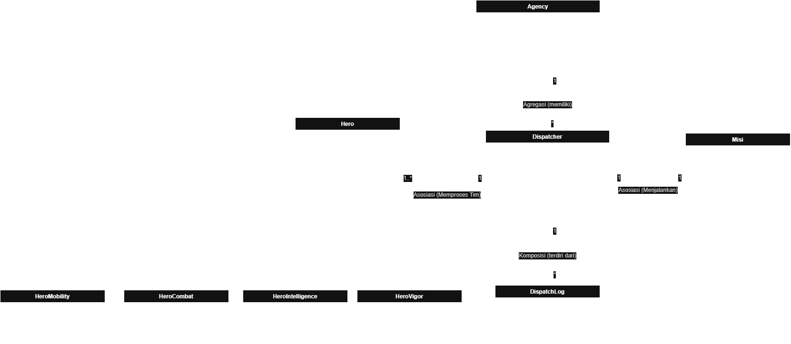

Keterangan simbol:
- Garis putus-putus dengan panah (`..>`) menunjukkan asosiasi.
- Garis dengan belah ketupat kosong di sisi induk (`o--`) menunjukkan agregasi.
- Garis dengan belah ketupat hitam di sisi induk (`*--`) menunjukkan komposisi.

Ketiga relasi di bawah ini benar-benar ada di kode program.

### 1. Asosiasi: `Dispatcher` ke `Hero` dan `Dispatcher` ke `Misi`

`Dispatcher` hanya menggunakan objek `Hero` dan `Misi` sebagai parameter method `dispatch_tim_hero()`, tanpa menyimpannya sebagai atribut tetap. Karena itu hubungannya longgar: hero dan misi hidup mandiri dan hanya dipakai sementara saat dispatch berlangsung.

```python
def dispatch_tim_hero(self, tim_hero, misi):
```

```python
operator1.dispatch_tim_hero([hero1, hero3], inc1)
```

### 2. Agregasi: `Agency` ke `Hero` dan `Agency` ke `Dispatcher`

`Agency` menampung daftar hero dan dispatcher yang dibuat di luar, lalu dimasukkan lewat `tambah_hero()` dan `tambah_dispatcher()`. Jenis relasinya agregasi, bukan komposisi, karena hero dan dispatcher tetap bisa hidup mandiri walaupun `Agency` dihapus: mereka tidak dibuat oleh `Agency` dan dapat berpindah ke agency lain.

```python
class Agency:
    def __init__(self, nama):
        self.nama = nama
        self.daftar_hero = []
        self.daftar_dispatcher = []
```

```python
agency.tambah_hero(hero1)
agency.tambah_dispatcher(operator1)
```

### 3. Komposisi: `Dispatcher` ke `DispatchLog`

`DispatchLog` dibuat langsung di dalam `Dispatcher` (pada method `dispatch_tim_hero()`) dan disimpan di atribut private `__logs`. Jenis relasinya komposisi, bukan agregasi, karena log tidak dibuat di luar, tidak dipakai bersama objek lain, dan tidak bermakna tanpa dispatcher yang mencatatnya. Jika `Dispatcher` dihapus, log miliknya ikut hilang.

```python
self.__logs = []
```

```python
self.__logs.append(DispatchLog(self.nama_operator, misi.nama_kejadian, True))
```

### Ringkasan perbedaan agregasi dan komposisi

| Aspek | Agregasi (`Agency`) | Komposisi (`Dispatcher` dan `DispatchLog`) |
|---|---|---|
| Lokasi pembuatan objek bagian | Di luar, lalu dikirim ke penampung | Langsung di dalam objek induk |
| Bentuk kepemilikan | Referensi bebas | Eksklusif milik satu induk |
| Dapat hidup mandiri | Ya | Tidak |
| Saat induk dihapus | Hero dan dispatcher tetap ada | Log ikut musnah |

------------------------------------------------------------------------------------------------------------------------------------------------

## Inheritance yang Diterapkan

Program menerapkan konsep inheritance dengan struktur berikut:

```text
Hero (abstract)
├── HeroCombat
├── HeroIntelligence
├── HeroMobility
└── HeroVigor
```

### Superclass

Superclass / parent class:

```python
class Hero(ABC):
```

### Subclass

Subclass / child class:

```python
class HeroCombat(Hero):
class HeroIntelligence(Hero):
class HeroMobility(Hero):
class HeroVigor(Hero):
```

### Penggunaan `super()`

Setiap subclass memanggil constructor milik superclass menggunakan `super().__init__(...)`.

Contoh:

```python
class HeroCombat(Hero):
    def __init__(self, nama, power_level, persentase_sukses, senjata, status="Standby"):
        super().__init__(nama, power_level, persentase_sukses, status)
        self.senjata = senjata
```

### Atribut Tambahan Setiap Subclass

| Subclass | Atribut Unik |
|---|---|
| `HeroCombat` | `senjata` |
| `HeroIntelligence` | `gadget` |
| `HeroMobility` | `speed_level` |
| `HeroVigor` | `stamina` |

### Method Overriding

Method `tampilkan_stats()` dan `aksi_khusus()` dari class `Hero` dioverride oleh setiap subclass.

Contoh pada `HeroCombat`:

```python
def tampilkan_stats(self):
    print(self.info_dasar() + f" | Senjata: {self.senjata}")

def aksi_khusus(self):
    print(f"{self.nama} menyerang menggunakan {self.senjata}!")
```

### Protected dan Private

Protected attribute pada superclass:
```python
self._nama
self._status
```

Private attribute pada superclass:
```python
self.__persentase_sukses
self.__id_hero
```

Atribut protected digunakan oleh subclass, sedangkan atribut private digunakan untuk data yang harus dibatasi aksesnya.

| Atribut | Visibilitas | Akses dari luar |
|---|---|---|
| `_nama` | Protected | Property `nama` (read-only) |
| `_status` | Protected | Property `status` (getter dan setter) |
| `__persentase_sukses` | Private | Property `persentase_sukses` (setter dengan validasi) |
| `__id_hero` | Private | Property `id_hero` (read-only) |

------------------------------------------------------------------------------------------------------------------------------------------------

## Abstraksi (Abstract Base Class)

Abstraksi diterapkan dengan modul `abc` (`ABC` dan `@abstractmethod`). Abstract class berfungsi sebagai kontrak yang memaksa kelas anak mengimplementasikan method tertentu. Jika ada method yang belum diimplementasikan, error langsung muncul saat objek dibuat, bukan saat method dipanggil.

### Abstract class `Hero`

```python
class Hero(ABC):
    ...
    @abstractmethod
    def tampilkan_stats(self):
        pass

    @abstractmethod
    def aksi_khusus(self):
        pass
```

`Hero` memiliki 2 abstract method, yaitu `tampilkan_stats()` dan `aksi_khusus()`.

### Subclass yang mengimplementasikan seluruh abstract method

| Subclass | `tampilkan_stats()` | `aksi_khusus()` |
|---|---|---|
| `HeroCombat` | menampilkan data + `senjata` | menyerang menggunakan senjata |
| `HeroIntelligence` | menampilkan data + `gadget` | menganalisis situasi dengan gadget |
| `HeroMobility` | menampilkan data + `speed_level` | bergerak cepat sesuai `speed_level` |
| `HeroVigor` | menampilkan data + `stamina` | menampilkan besar `stamina` |

Keempat subclass tetap memakai `super().__init__(...)`, memiliki atribut unik masing-masing, serta memakai atribut protected (`_nama`, `_status`) dan private (`__persentase_sukses`, `__id_hero`) dari `Hero`.

### Method konkret yang dipakai bersama

`Hero` juga memiliki method biasa (konkret) yang diwarisi dan dipakai oleh semua subclass:

- `info_dasar()` menyusun teks data dasar hero. Dipanggil di dalam `tampilkan_stats()` milik setiap subclass.
- `beristirahat()` mengembalikan status hero dari `Resting` ke `Standby`.

Pola ini sama seperti `jalankan()` pada materi: alur umum ditulis sekali di abstract class, sedangkan bagian yang berbeda diserahkan ke subclass.

### Bukti abstract class tidak dapat diinstansiasi

```python
try:
    Bunny = Hero("Bunny", 1, 50)
except TypeError as e:
    print("[Bukti ABSTRAKSI] Tidak bisa instansiasi Hero:", e)
```

Output:

```text
[Bukti ABSTRAKSI] Tidak bisa instansiasi Hero: Can't instantiate abstract class Hero without an implementation for abstract methods 'aksi_khusus', 'tampilkan_stats'
```

Error `TypeError` muncul saat `Hero(...)` dipanggil, sebelum ada data yang diproses.

Abstract class kedua adalah `MissionEvaluator` (method abstrak `nilai()`), yang diimplementasikan oleh `TypeEvaluator` dan `SuccessRateEvaluator`. Pemakaiannya dijelaskan di bagian SOLID.

------------------------------------------------------------------------------------------------------------------------------------------------

## Polimorfisme

Polimorfisme berarti satu interface dengan banyak implementasi: kode yang sama dapat bekerja dengan objek bertipe berbeda selama objek tersebut memiliki method yang diharapkan.

### 1. Polimorfisme via pewarisan (method overriding)

Method `aksi_khusus()` dan `tampilkan_stats()` di-override oleh `HeroCombat`, `HeroIntelligence`, dan `HeroMobility` dengan perilaku berbeda. Pemanggilannya lewat satu loop yang berisi objek dari subclass berbeda:

```python
for hero in [hero1, hero2, hero3]:
    hero.aksi_khusus()
```

Output:

```text
Invisigal menganalisis situasi dengan gadget Smart Glasses!
Blonde Blazer menyerang menggunakan Necklace Power!
Coupe bergerak cepat dengan speed level 10!
```

`hero4` (`HeroVigor`) dipanggil dengan cara yang sama dan ikut menunjukkan polimorfisme:

```python
hero4.aksi_khusus()
```

```text
Golem mempunyai stamina sebesar 98!
```

Loop tidak perlu tahu tipe hero. Python memilih implementasi yang sesuai saat program berjalan (*dynamic dispatch*).

### 2. Duck typing

`Competingcalls` dan `Hackcalls` tidak berhubungan lewat pewarisan, tetapi keduanya memiliki method `tangani()`. Keduanya dipanggil lewat satu fungsi yang sama:

```python
def proses_panggilan(panggilan):
    panggilan.tangani()

proses_panggilan(Competingcalls("Selamatkan bank", "Selamatkan sekolah. Jika tidak memilih maka opsi tersebut akan menghilang!"))
proses_panggilan(Hackcalls("sistem keamanan gedung"))
```

Output:

```text
Pilih satu: 'Selamatkan bank' atau 'Selamatkan sekolah. Jika tidak memilih maka opsi tersebut akan menghilang!'.
[HACKING] Tidak ada hero dikirim atau membantu hero, operator meretas sistem keamanan gedung.
```

`proses_panggilan()` hanya membutuhkan objek yang memiliki `tangani()`, tanpa peduli kelas atau pewarisannya.

### 3. Operator overloading

| Magic method | Kelas | Fungsi |
|---|---|---|
| `__lt__` | `Hero` | Membandingkan hero berdasarkan `power_level`, sehingga operator `<` dan fungsi `max()` dapat dipakai pada objek hero |
| `__str__` | `DispatchLog` | Menentukan tampilan log saat objek di-`print()` |

```python
print(f"{hero1.nama} ({hero1.power_level}) < {hero2.nama} ({hero2.power_level}) ? {hero1 < hero2}")
print(f"{hero2.nama} ({hero2.power_level}) < {hero3.nama} ({hero3.power_level}) ? {hero2 < hero3}")
print("Hero terkuat (max):", max(hero1, hero2, hero3).nama)
```

Output:

```text
__lt__ : Invisigal < Blonde Blazer ? True
Hero terkuat (max): Blonde Blazer
```

Perbandingan lain di `main.py` memakai `__lt__` pada hero dari subclass berbeda:

```python
print(f"{hero2.nama} ({hero2.power_level}) < {hero3.nama} ({hero3.power_level}) ? {hero2 < hero3}")
```

```text
Blonde Blazer (90) < Coupe (75) ? False
```

Contoh `__str__` pada log dispatch:

```text
[LOG] SUKSES | Operator: Player 1 | Misi: Penyelidikan Villain
[LOG] GAGAL | Operator: Player 1 | Misi: Penyelidikan Villain
```

------------------------------------------------------------------------------------------------------------------------------------------------

## Penerapan Prinsip SOLID

Program menerapkan tiga prinsip SOLID. Ketiganya benar-benar ada di kode. Prinsip SRP dan ISP tidak diklaim karena tidak ada bagian kode yang dibuat khusus untuk keduanya.

### 1. DIP (Dependency Inversion Principle) — penerapan utama

Kelas tingkat tinggi `Dispatcher` bergantung pada abstraksi `MissionEvaluator`, bukan pada kelas penilai tertentu. Objek penilai dikirim dari luar lewat constructor (*dependency injection*):

```python
class MissionEvaluator(ABC):
    @abstractmethod
    def nilai(self, tim, misi):
        pass

class Dispatcher:
    def __init__(self, nama_operator, kode_akses, penilai: MissionEvaluator = None):
        ...
        self.penilai = penilai if penilai is not None else TypeEvaluator()
```

`Dispatcher` memanggil `self.penilai.nilai(tim_hero, misi)` tanpa tahu jenis penilainya. Jika `penilai` tidak diberikan, `TypeEvaluator` dipakai sebagai nilai default agar `Dispatcher` tetap mudah dibuat. Pengujiannya di `main.py`:

```python
operator1 = Dispatcher("Player 1", "PASS-1234")                                       # default: TypeEvaluator
operator2 = Dispatcher("Player 2", "PASS-5678", penilai=SuccessRateEvaluator(90))     # disuntikkan dari luar
```

Output, misi yang sama dengan hero yang sama dinilai berbeda oleh dua `Dispatcher` yang kodenya tidak diubah:

```text
Operator 1 (TypeEvaluator, default):
[DISPATCH] Player 1 memproses 'Penyelidikan Villain'...
TypeEvaluator memeriksa tipe tim ['Combat'] terhadap syarat misi ['Intelligence', 'Mobility']
[MISI GAGAL] Tim tidak memenuhi penilaian misi.
...
Operator 2 (SuccessRateEvaluator, batas 90%):
[DISPATCH] Player 2 memproses 'Penyelidikan Villain'...
SuccessRateEvaluator: rata-rata tim 95.0%, dibutuhkan 93%
[MISI SUKSES] Tim berhasil!
```

### 2. OCP (Open/Closed Principle)

Cara menilai misi baru cukup ditambahkan dengan membuat subclass `MissionEvaluator` baru (misalnya penilai berdasarkan `power_level`), tanpa mengubah `Dispatcher`, `TypeEvaluator`, maupun `SuccessRateEvaluator`. Kode lama tetap tertutup untuk diubah, tetapi terbuka untuk ditambah. Tidak ada rantai `if/elif` yang perlu dipanjangkan setiap ada aturan penilaian baru.

OCP juga terlihat pada hierarki hero: `HeroVigor` ditambahkan sebagai subclass baru tanpa mengubah `Hero` maupun subclass lain (`HeroCombat`, `HeroIntelligence`, `HeroMobility`).

### 3. LSP (Liskov Substitution Principle)

Semua subclass `Hero` (termasuk `HeroVigor`) dan semua subclass `MissionEvaluator` menepati kontrak parent-nya, tanpa method yang hanya melempar error. Karena itu `Dispatcher.dispatch_tim_hero()` menerima hero apa pun, dan `Dispatcher` memakai penilai apa pun tanpa perilaku aneh.

### Ringkasan

| Prinsip | Penerapan di program |
|---|---|
| DIP | `Dispatcher` menerima `penilai: MissionEvaluator` dari luar lewat constructor, tidak membuat penilai konkret sendiri secara permanen |
| OCP | Penilai baru cukup berupa subclass baru dari `MissionEvaluator`, dan `HeroVigor` ditambahkan sebagai subclass `Hero` baru, tanpa mengubah kode yang sudah ada |
| LSP | `HeroCombat`, `HeroIntelligence`, `HeroMobility`, `HeroVigor`, `TypeEvaluator`, dan `SuccessRateEvaluator` dapat menggantikan parent-nya tanpa error |

------------------------------------------------------------------------------------------------------------------------------------------------

## Pengujian Program

Pengujian dilakukan langsung pada bagian *main code* dengan beberapa skenario berikut.

### 1. Pengujian Data Hero dan Inheritance

Menguji pembuatan objek hero dari subclass dan pemanggilan method `tampilkan_stats()`.

```python
hero1 = HeroIntelligence("Invisigal", 85, 90, "Smart Glasses")
hero2 = HeroCombat("Blonde Blazer", 90, 95, "Necklace Power")
hero3 = HeroMobility("Coupe", 75, 85, 10)
hero4 = HeroVigor("Golem", 90, 60, 98)

hero1.tampilkan_stats()
hero2.tampilkan_stats()
hero3.tampilkan_stats()
hero4.tampilkan_stats()
```

### 2. Pengujian Class Attribute, Static Method, dan Class Method

Menguji atribut class, static method, dan class method pada class `Hero`.

```python
print("Total Hero:", Hero.total_hero)
print("Nama Agency:", Hero.nama_agency)
print("Maksimal Tim:", Hero.maksimal_tim_dispatch)

print("Tipe Intelligence:", Hero.validasi_tipehero("Intelligence"))
print("Tipe Cybernetic:", Hero.validasi_tipehero("Cybernetic"))

print("Maksimal Tim sebelum:", Hero.maksimal_tim_dispatch)
Hero.ubah_maksimal_tim(4)
print("Maksimal Tim sesudah:", Hero.maksimal_tim_dispatch)
```

### 3. Pengujian Abstract Class

Membuat objek `Hero` langsung harus gagal dengan `TypeError`.

```python
try:
    Bunny = Hero("Bunny", 1, 50)
except TypeError as e:
    print("[Bukti ABSTRAKSI] Tidak bisa instansiasi Hero:", e)
```

### 4. Pengujian Polimorfisme (Override)

Setiap subclass memanggil `aksi_khusus()` lewat satu loop, tetapi output yang ditampilkan berbeda.

```python
for hero in [hero1, hero2, hero3]:
    hero.aksi_khusus()
hero4.aksi_khusus()
```

### 5. Pengujian Duck Typing

```python
proses_panggilan(Competingcalls("Selamatkan bank", "Selamatkan sekolah. Jika tidak memilih maka opsi tersebut akan menghilang!"))
proses_panggilan(Hackcalls("sistem keamanan gedung"))
```

### 6. Pengujian Operator Overloading

```python
print(f"__lt__ : {hero1.nama} < {hero2.nama} ? {hero1 < hero2}")
print("Hero terkuat (max):", max(hero1, hero2, hero3).nama)
operator1.tampilkan_log()   # memakai __str__ pada DispatchLog
```

### 7. Pengujian Class `Misi`

Menguji pembuatan objek misi dan menampilkan detail misi.

```python
inc1 = Misi("INC-01", "Penyelidikan Villain", "Downtown", ["Intelligence", "Mobility"], 150)
inc2 = Misi("INC-02", "Kebakaran Gedung", "Sector 7", ["Combat"], 80)

inc1.info_misi()
inc2.info_misi()

print(f"Batas waktu respon: {Misi.batas_waktu_respon_detik} detik")
```

### 8. Pengujian Class `Dispatcher`

Menguji pembuatan operator dispatcher (dengan penilai default dan penilai yang disuntikkan), menampilkan info operator, dan verifikasi kode akses.

```python
operator1 = Dispatcher("Player 1", "PASS-1234")
operator2 = Dispatcher("Player 2", "PASS-5678", penilai=SuccessRateEvaluator(90))

operator1.info_operator()
operator2.info_operator()

print(operator1.verif_access("PASS-1234"))
print(operator1.verif_access("SALAH"))
```

### 9. Pengujian Asosiasi

Menguji relasi asosiasi ketika `Dispatcher` menggunakan objek `Hero` dan `Misi` melalui parameter method.

```python
operator1.dispatch_tim_hero([hero1, hero3], inc1)
```

Pada contoh di atas:
- `operator1` adalah objek `Dispatcher`
- `[hero1, hero3]` adalah tim hero
- `inc1` adalah objek `Misi`

### 10. Pengujian DIP (Dependency Inversion)

Misi yang sama dinilai oleh dua `Dispatcher` dengan penilai berbeda, tanpa mengubah kelas `Dispatcher`.

```python
operator1.dispatch_tim_hero([hero2], inc1)   # TypeEvaluator: gagal
hero2.beristirahat()
operator2.dispatch_tim_hero([hero2], inc1)   # SuccessRateEvaluator: sukses
```

### 11. Pengujian Komposisi

Menguji log dispatch yang dibuat oleh class `Dispatcher`.

```python
operator1.tampilkan_log()
```

Log dibuat menggunakan class `DispatchLog` di dalam class `Dispatcher`.

### 12. Pengujian Agregasi

Menguji class `Agency` yang menampung daftar hero dan dispatcher.

```python
agency = Agency("Phoenix Agency")

agency.tambah_hero(hero1)
agency.tambah_hero(hero2)
agency.tambah_hero(hero3)
agency.tambah_hero(hero4)

agency.tambah_dispatcher(operator1)
agency.tambah_dispatcher(operator2)

print("Jumlah Hero:", len(agency.daftar_hero))
print("Jumlah Dispatcher:", len(agency.daftar_dispatcher))
```

### 13. Pengujian Status Hero

Menguji perubahan status hero dari `Resting` kembali menjadi `Standby`.

```python
hero1.tampilkan_stats()
hero1.beristirahat()
hero1.tampilkan_stats()
```

### 14. Pengujian Setter dengan Data Valid

Menguji perubahan nilai atribut private melalui setter menggunakan data valid.

```python
hero2.persentase_sukses = 98
inc2.reputasi_reward = 120
```

### 15. Pengujian Setter dengan Data Tidak Valid

Menguji validasi setter menggunakan data yang tidak valid.

| Uji | Atribut | Nilai | Hasil yang diharapkan |
|---|---|---|---|
| 1 | `persentase_sukses` | `150` | `ValueError` (di luar 0% - 100%) |
| 2 | `persentase_sukses` | `'Sangat Tinggi'` | `ValueError` (bukan angka) |
| 3 | `total_dispatch` | `-5` | `ValueError` (tidak boleh negatif) |
| 4 | `reputasi_reward` | `0` | `ValueError` (harus lebih dari 0) |

```python
try:
    hero2.persentase_sukses = 150
except ValueError as e:
    print("[ERROR]", e)

try:
    hero2.persentase_sukses = "Sangat Tinggi"
except ValueError as e:
    print("[ERROR]", e)

try:
    operator1.total_dispatch = -5
except ValueError as e:
    print("[ERROR]", e)

try:
    inc2.reputasi_reward = 0
except ValueError as e:
    print("[ERROR]", e)
```

------------------------------------------------------------------------------------------------------------------------------------------------

## Screenshot Output Program

### Bukti Abstract Class Tidak Dapat Diinstansiasi

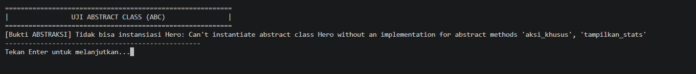

### Polimorfisme (Override), Duck Typing, dan Operator Overloading

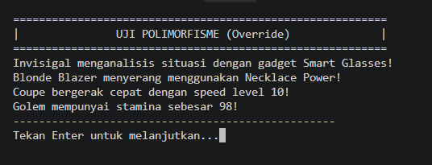

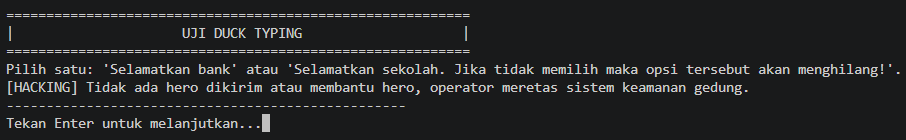

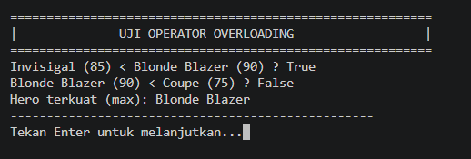

### Asosiasi, DIP, Komposisi, dan Agregasi

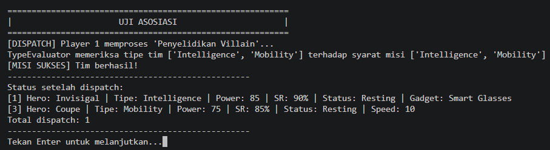

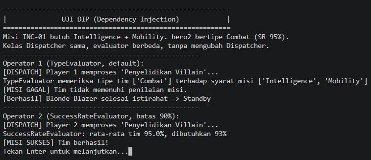

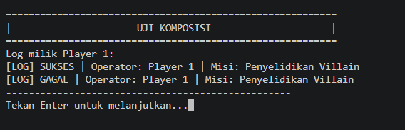

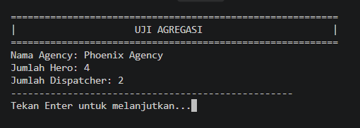

### Setter Valid dan Tidak Valid

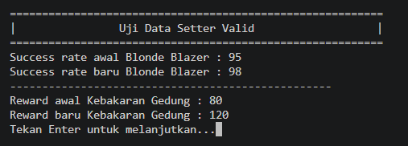

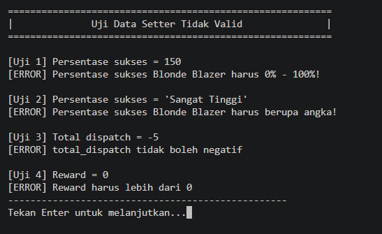

------------------------------------------------------------------------------------------------------------------------------------------------

## Persyaratan Sistem

Untuk menjalankan program ini, pastikan sistem telah terinstal:

* **Python** versi 3.8 atau yang lebih baru.

------------------------------------------------------------------------------------------------------------------------------------------------

## Cara Menjalankan Program

1. Simpan kedua file berikut di folder yang sama:

```text
main.py
posttest3_2509106066_AryasatyaRakhaPhanyputa.py
```

2. Buka terminal, Command Prompt (CMD) atau Vs code.

3. Arahkan terminal ke folder tempat file `main.py` disimpan.

4. Jalankan program dengan perintah berikut:

```bash
python main.py
```

5. Saat program berjalan, tekan **Enter** untuk melanjutkan ke pengujian berikutnya. Terminal akan dibersihkan otomatis sebelum masuk ke bagian berikutnya.

------------------------------------------------------------------------------------------------------------------------------------------------